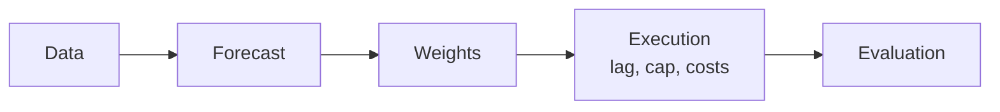

# volatility-managed-portfolio
Test and Implement volatility based strategy on managing portfolios risk

## Summary: Phases 1–9

**Question.** Does scaling a diversified factor portfolio by the inverse of its own forecast variance beat holding the same portfolio? Every choice is made in real time, from past data only, and judged after costs on data no choice ever saw.

**Design.**
- **Data.** Development is 1926–2018. A holdout (January 2019 to August 2026) was sealed by content hash before any modelling and opened once, on 20 October 2026.
- **The strategy.** Each year-end, a screen picks the factors whose risk is predictable and poorly paid. They are mixed by inverse volatility. A GJR-GARCH forecast sets the size each month (c_t / σ̂², capped at 1.5), with c_t estimated in real time.
- **The test,** fixed in advance: the Sharpe gain over the same book held at size 1, one-sided at 5%, read as "edge", "inconclusive" or "no meaningful edge". It is always reported with the smallest gain it could detect.
- **The record.** Every rule is in a dated entry in [PREREGISTRATION.md](PREREGISTRATION.md) before its result, and rule tables are pinned by fingerprint.

**Result: inconclusive, consistent with Cederburg et al. (2020).**

| Book (holdout, 2019–2026) | Months | Sharpe, timed / buy-and-hold | Gain (p) |
|---|---|---|---|
| **Primary: the final test** | 91 | 0.744 / 0.656 | **+0.088 (0.31)** |
| Best of 192 development variants | 91 | 0.651 / 0.765 | −0.114 (0.74) |
| SPY alone, after costs | 92 | 0.790 / 0.891 | −0.102 (0.73) |
| SPY + MTUM tilt, after costs | 92 | 0.482 / 0.468 | +0.015 (0.47) |
| Fixed asset list (information) | 91 | 0.857 / 0.777 | +0.080 (0.32) |

- **The holdout can detect only large gains.** Its minimum detectable effect is 0.45. Detecting +0.088 would take about 200 years of data.
- **The development edge needed hindsight.** With the asset list screened in real time, timing gained +0.013 on development. With the list chosen on the full sample it gained +0.355, which shrank to +0.08 on the holdout.
- **What timing reliably did was cut risk.** It ran at lower volatility, with smaller drawdowns, and cut size before most of the worst days in 2008, 2020 and 2022. Part of the drawdown cut is just the smaller size. The cost: missed rebounds (SPY +19% against +77% after March 2020) and a lower certainty-equivalent return.
- **Side findings.**
  - Forecast accuracy did not track strategy value (rank correlation −0.05).
  - The models' Sharpe ranking followed their average size (+0.76).
  - One market-only year (1984) decided the development verdict.
- **Limits.** Paper-factor results are upper bounds: no costs, and BAB is not tradeable. Every sample is short for effects this small.

**Full report:** [reports/research_report.md](reports/research_report.md). **Since then (Phase 10, end of this file):** three follow-ups on development data found no new edge, and none reached a holdout. They were a variance-risk-premium signal, four fixes to the timing rule, and the rule as a pure risk overlay. Their findings are in the report's postscript.

## Phase 1: Data and Set up

```bash
pip install -r requirement.txt
python -m src.data.build      # snapshot sources, build panels, run the pass rule
python -m pytest              # unit tests
```

The build writes `reports/phase1_data_report.md` (pass rule, coverage, sources) and
`data/events/event_dates.csv` (every FOMC, CPI and jobs-report date, with where it came from).

```python
from src.data.load import load_dev, load_etf_ohlc_dev

panel = load_dev()   # one row per trading day, 1926-07-01 .. 2018-12-31
```

`panel` columns: factor excess returns `mkt smb hml mom rmw cma bab`, ETF excess returns
`spy mtum qual usmv`, `rf`, `vix` and event flags `fomc cpi jobs`.

The holdout (2019 onward) sits in separate files, sealed by a content hash in
`data/holdout_lock.json`. It is opened once, in Phase 9, with
`load_holdout(confirm="phase 9 final test")`, and every opening is logged in
`data/holdout_access_log.csv`.

ETF history is short: MTUM and QUAL start in 2013 and USMV in 2011, leaving 5 to 7 years before 2019,
under the 10-year initial training window. So ETFs are never tuned on. Every model and cutoff is chosen
from the paper factors, and the ETFs are only checked against those choices.


## Phase 2: Variance and EDA

Variance:


Tests:
- 

- 

- 

- Test 4: to measure if its rewarding more if we hold less on the assets on risky times, if not then it would just be better for us to buy&hold. How it works:
1. Each month, score how volatile and record the returns and variance of each assets
2. Sort each pile of months from calmest to wildest and for each pile, compute their avg returns, variance, then the ratio
3. Then managed the return as for each month, multiply the next return by a weight which is c + last month variance. After a wild month, hold less, after a calm month, hold more
4. The constant c is set in order for managed and original have the asme volatility and allow them to be comparable, and not by their values
5. Compare managed with original: with regression managed: a + B * original then t-test to minimize chance of luck

## Phase 3: Assets Screening

Assets Screening with multiple filters to keep only assets with chance of success.

Filters:
- Predictable Risks: from test on phase 2, test 1 (fail: nothing to forecast). Result: all predictable

- Moving Risks: SD of log RV to measure how much variance moves (the idea is that if the risks is not moving with time, which is flat risk, then our whole idea of strategy would be useless as it would just be the same as buy&hold). Result: NO asset is flat

- Exploitability for Strats: risk to reward ratio on how our assets can be exploited, where the reward must fall when the risk rises. Such that our strategy of reducing out position weight can be reduced when its getting risky. If the risk and reward is one on one, then there is no use to adjust our position based on the risk. Test from Phase 2, test 4 (the test measures how rewarding is it from risky times compared to calm times). Result: Only 3 assets: Market, Momentum, and BAB.

- Stability: to ensure that the Strats is stable and applicable in all eras of time such that the Strats is still viable and not just based on specific era. Test: using the phase 2 test 4, implemented on splitting the history into 3 eras, then check if the a variable stays > 0 as a consistency check that the Strats is not a single era accident. The 3 eras are equal thirds of the history available at the as-of date (not fixed calendar years), so the filter never reads data from after that date and can run in real time.

- Systematic Risk (ETF): a long-only ETF is mostly market, so any ETF would pass an R² test on market exposure alone. The test therefore hedges the market out first (ETF minus its market beta times the market), then regresses the leftover tilt on market, size, value, momentum and BAB, and requires R² > 0.5. SPY is the market itself, so it is tested unhedged. Result: SPY and MTUM pass; USMV (0.38) and QUAL (0.17) fail.

- Tradeable (ETF): median daily dollar volume over the last 252 trading days above $50 million. The bid-ask spread half of the rule is not applied (no quote data).

Result: only Market (SPY) and Momentum (MTUM) survive. Betting-against-beta passes every factor filter but its ETF, USMV, fails the systematic risk filter.


## Phase 4: Portfolio Construction

Combine the survivors into one portfolio, then time that single portfolio (`src/portfolio.py`, report `reports/phase4_portfolio.ipynb`).

- Step 1, remove duplicates: drop one of any pair whose monthly returns correlate above +0.7, on all months or on the 10% most volatile months (a negative correlation is a hedge, not a duplicate). Result: nothing is cut. Market-momentum -0.30 (-0.58 in crises), market-BAB -0.14, momentum-BAB +0.27 (+0.44 in crises). Raw MTUM/QUAL/USMV correlate 0.89-0.98 with SPY, so the ETF track trades MTUM's hedged tilt (MTUM - β × SPY), which correlates -0.18 with SPY.

- Step 2, choose weights: four mixes (equal, inverse variance, inverse volatility, shrunk mean-variance), set every year-end from the last 10 years of daily returns and held for the next year. Inverse volatility is the primary.

- Step 3, combine then time: p = Σ wᵢ rᵢ; serving size = c / last month's variance of p, capped at 1.5x (1.0x, 2.0x and no cap in Phase 8); exposure to asset i = size × wᵢ. Tests 1 and 4 from Phase 2 are re-run on p (level φ is the gate, log φ reported beside it).

Tracks: paper (market + momentum + BAB, from 1941, the primary), ETF (SPY + MTUM tilt, from 2015: too short to judge), and paper market + momentum (the ETF track's long-history twin).

Result: the primary passes (Test 1 φ 0.514, Test 4 α 4.2% a year, t 6.1), so the phase passes, but Test 1 only narrowly, and it is an upper bound because the paper track holds BAB, which cannot be traded. Mixing lifts the Sharpe ratio from 0.55-0.85 for each piece to 1.14-1.17: that buy-and-hold mix is the bar timing has to beat.

```python
from src import portfolio as pf
rec = pf.recipes(panel, "paper")        # recipe per year-end and mix, from past data only
out = pf.returns(panel, "paper", rec)   # daily p, serving size and timed return per mix
pf.tests(out[("inv_vol", "p")])         # Tests 1 and 4 on the primary
```


## Phase 5: Strategy rules and the backtest engine

A backtester verified on simulated data before any real-data result is read (`src/engine/`, report `reports/phase5_engine.ipynb`, hand check `reports/phase5_hand_check.xlsx`).



Five modules, each tested alone (`test/test_engine.py`): `data` (what is traded: daily excess returns, rf, positions per unit of size), `forecast` (next month's variance from data up to each month-end), `weights` (size = c_t × signal, capped), `execution` (trade at the month-end close, drift, trading cost, borrowing, short fee), `evaluation` (Sharpe ratio, spanning alpha, break-even cost, placebo). A new forecast model is a function passed as `forecaster`; nothing else changes.

- Timing rules: inverse variance (c_t / σ̂², the primary), inverse volatility (c_t / σ̂), downside inverse volatility (c_t / σ̂⁻). Until Phase 6 picks a model, σ̂² is last month's realized variance.
- c_t in real time: sd(r_{s+1}) / sd(r_{s+1} × signal_s) over the months up to t (at least 120 pairs; 36 on the ETF track, Phase 7's three-year rule), so every rule carries buy-and-hold's risk without using future data. It is computed on the mix held next month, applied to all past data.
- Size between 0 and 1.5 (1.0 and 2.0 in Phase 8). Trading cost κ × |w_t − w̃_t| with drifted weights w̃; κ = 5 bp for SPY and 10 bp for factor ETFs; borrowed cash pays rf + 0.5% a year; the SPY short pays 0.25% a year (1% in Phase 8's stress test). Paper factors are before costs. Two kinds of break-even κ are reported, neither compared with Barroso and Santa-Clara's figures (which include trading inside the factor).
- Benchmark: the same book at size 1, traded on the same dates at the same costs.

Engine checks (`test/test_engine_checks.py`), all on simulated data, all passing:

| Check | Setup | Result |
|---|---|---|
| Two worlds | GARCH, 500 years; A: μ constant, B: μ ∝ σ² | A: α +1.95% (t 6.0); B: α +0.13% (t 0.4) |
| Constant forecast | σ̂² fixed, costs off | size exactly 1 (real-time c_t); α of order 10⁻¹⁶ |
| Shuffled forecast | 1,000 reorderings in time | mean alpha +0.002%; real beats 100% in A (pass), 67% in B (fail) |
| Oracle | next month's actual variance | A: +0.02 Sharpe over the baseline; unpredictable variance: +0.23 |
| Hand check | 5 months rebuilt with spreadsheet formulas | 70 numbers match to 2 × 10⁻¹⁴; 7 planted bugs all caught |

Placebo rule for the real data (from Phase 6): the real alpha must beat 95% of 1,000 shuffled alphas.

The primary test (PREREGISTRATION Entry 3) is the Sharpe gain over buy-and-hold, one-sided at 5%, with three readings: **edge** if it rejects, **no meaningful edge** if the one-sided 95% upper bound is below 0.10 a year, **inconclusive** otherwise. It is reported with the minimum detectable effect at 80% power, both runs' realized volatility and the average size. Its power is low. On simulated data it rejects in 30% of 90-year histories with a true edge (minimum detectable effect 0.18) and in 10% of holdout-length ones (0.46).

```python
from src import engine as e
from src import portfolio as pf
book = e.data.from_phase4(panel, pf.recipes(panel, "paper"), "inv_vol")   # the primary book
res = e.run(book, "inv_var")            # one row per holding month: decision, timed account, bench_ account
e.evaluation.sharpe_gain_test(res)     # the primary test: gain, bounds, reading, minimum detectable effect
e.placebo(book, "inv_var")              # real alpha vs 1,000 shuffled forecasts
```

```bash
python -m src.engine.handcheck          # rebuild the hand-check workbook (needs xlsxwriter and formulas)
```


## Phase 6: Forecast models

Which variance forecast makes the strategy work best, not just which has the smallest error (`src/models/`, report `reports/phase6_forecasts.ipynb`, rules in PREREGISTRATION Entries 4 and 5).

Every model forecasts the same thing: at each month-end close, the total variance of the next 22 trading days (one holding month), from data up to that close. Each runs its own expanding-window walk-forward on every recipe's mix. The fitted models are refit at every month-end (boosting yearly), and the direct models drop the last 22 days of training targets, because those targets overlap the forecast period.

| Model | Forecast | Expected to help if |
|---|---|---|
| M0 Rolling RV | Σ r² over the last 22 days | the papers' baseline |
| M1 EWMA | 22 × EWMA of r², λ = 0.94 | no fitting |
| M2 GARCH(1,1) | h-step forecasts summed over 22 days | short memory |
| M3 GJR-GARCH | GARCH plus a kick after down days | asymmetry |
| M4 HAR, log | log 22-day RV on 1-, 5-, 22-day log RV, direct, bias-corrected | long memory |
| M5 Downside HAR | M4 plus each lag's down-day share | long memory plus asymmetry |
| M6 HAR-X | M4 (Test 3 failed) plus log VIX variance and scheduled-event counts | VIX adds information |
| M7 Gradient boosting | M6's inputs, QLIKE (gamma) loss, tuned by an inner walk-forward | nonlinearity |

Two scorecards, on the same months:
- **A. Accuracy:** QLIKE, with the Model Confidence Set at 90%.
- **B. Strategy value:** each forecast plugged into the Phase 5 engine at the primary specification. Sharpe ratio, CER (γ = 5), volatility, the primary test, the placebo.

The rule, fixed in advance: **the simplest model inside the MCS whose Sharpe ratio is within one standard error of the best** (the error of the gap, by the primary test's method).

Results (development sample; the primary book is an upper bound: paper BAB, no costs):

| | Primary (market + momentum + BAB), 1950–2018 | SPY reference (market factor, SPY's costs), 1946–2018 |
|---|---|---|
| Most accurate | M6 HAR-X (QLIKE 0.303); only M0 outside the MCS | M6 HAR-X (0.273); M0, M1, M7 outside the MCS |
| Sharpe ratio, eight models | 1.51–1.57 (buy-and-hold 1.21); all "edge", all pass the placebo | 0.50–0.53 (buy-and-hold 0.50); all "inconclusive" |
| Oracle (perfect forecast) | 2.22 | 1.12 |
| Accuracy vs value, rank correlation (Q4) | +0.10: accuracy is not the bottleneck | +0.62 |
| **Frozen choice** | **M3 GJR-GARCH**: best Sharpe; EWMA missed the rule by 0.002 | **M2 GARCH(1,1)** |

- **A perfect forecast would add far more than any of these models.** The oracle beats rolling RV by 0.6–0.7 Sharpe, while the eight models differ by only 0.03–0.06.
- **The Sharpe ranking follows the average size, not accuracy.** On the primary book the GARCH models sit mid-table on QLIKE but win on Sharpe. Their smooth forecasts let the real-time c_t hold a larger size (1.0 against rolling RV's 0.67), and the cap binds more often.
- **A bug was found and fixed after the first run (Entry 5).** The GARCH optimizer reported success at absurd parameters, and some GJR forecasts reached 10¹⁰ times the realized variance. That made the first run's choice for the primary (rolling RV) void. The fix scales ω and never accepts a worse likelihood than the start. Its estimates match the `arch` package to four decimals. The first run's tables are kept in `reports/phase6_first_run_*.csv`.

```python
from src import models as md
from src.models import build, scorecard as sc
specs = build.setup(panel)                       # "paper" and "spy": book, costs, the eight forecasters
res = sc.run(specs["paper"]["book"], specs["paper"]["fs"]["M3"], specs["paper"]["costs"])   # the frozen model in the engine
```

```bash
python -m src.models.build      # fill the forecast cache in parallel (about an hour on 10 cores the first time), run the placebos, write reports/phase6_*.csv
```


## Phase 7: Walk-forward evaluation

The strategy run as it would have run in real time, then tested honestly (`src/walkforward/`, report `reports/phase7_evaluation.ipynb`, rules in PREREGISTRATION Entry 6, outcome in Entry 7). Development sample only.

At every rebalance, using only data up to that close, the walk-forward does five things:
- re-screens all seven factors (at each year-end; filters 1, 3 and 6, level φ);
- rebuilds the mix (Phase 4);
- refits and forecasts (Phase 6's models);
- sets c_t and the size (cap 1.5);
- trades at that close.

A year whose screen admits nothing, or whose mix has no c_t yet, holds cash and is not scored. So the primary book scores 276 months: the market alone in 1984, then mixes of market, BAB, profitability and (from 2010) momentum over 1997–2018.

- **The primary test** stands alone, because it was fixed before the data: M3 GJR-GARCH, inverse-variance timing, inverse-volatility mix, monthly. Its statistic is Entry 3's Sharpe gain, by Ledoit-Wolf with a Newey-West covariance. It is reported with the CER gain (block bootstrap) and Cederburg et al.'s real-time combination test.
- **The family** is 8 forecasts × 3 timing rules × 4 mixes × 2 rebalancing frequencies (monthly, weekly) = 192 variants. It is read through Romano-Wolf stepdown and Holm-Bonferroni adjusted p-values, plus the deflated Sharpe ratio of the best variant. All bootstraps are stationary, with mean blocks of 6 and 12 months, and report the larger p-value.
- **The ETF track** re-runs the frozen choices on what can be traded, after costs: SPY alone with M2, and SPY plus MTUM's hedged tilt with M3.

Results (development sample; the paper book is an upper bound):

| | Sharpe, timed / buy-and-hold | Gain (p) | Reading |
|---|---|---|---|
| **Primary**, 276 months | 0.746 / 0.733 | +0.013 (0.47) | **inconclusive** (minimum detectable effect 0.45) |
| Family of 192 | median gain +0.09 | 1 raw p < 5%; **0** after Romano-Wolf or Holm | best variant's deflated Sharpe ratio 0.67 (bar 0.95) |
| Q3: models against M0 (168 tests) | median gains −0.01 to −0.03 | 0 after Romano-Wolf | no forecast beats rolling RV |
| Q4: accuracy against value | rank correlation −0.05 | — | accuracy is not the bottleneck |
| ETF track: SPY alone, after costs, 1997–2018 | 0.582 / 0.417 | +0.165 (0.13) | inconclusive |
| Phase 6's fixed book (full-sample assets) | 1.567 / 1.211 | +0.355 (0.0002) | edge |

- **The primary also loses on CER** (3.5% against 4.1%) and fails the placebo (86% against the 95% bar). Its combination test is positive but not significant: +0.85 points, p 0.09.
- **What timing does reliably here** is cut drawdowns, in all 192 variants (−19% against −34% for the primary), by running at lower volatility.
- **One year decides the verdict** (information, added after the run).
  - In 1984 the book is the market alone, at 19% volatility against 2–9% for the mixes that follow. It lost.
  - Over 1997–2018 alone the primary gains +0.30 (p 0.012), and 65 of 192 variants survive Romano-Wolf.
  - Phase 6's fixed book gains +0.61 on the same 276 months, so the asset list, not the years, removed Phase 6's edge.
  - How to score a one-asset year in the holdout is an open decision (Entry 7, item 9).

```python
from src.data.load import load_dev, load_etf_ohlc_dev
from src import models as md
from src.engine import execution
from src.walkforward import runs, screened

panel, ohlc = load_dev(), load_etf_ohlc_dev()
rec = screened.recipes(panel, screened.survivors(screened.screen_all(panel, ohlc, jobs=-2)))
book = screened.book(panel, rec, "inv_vol", freq="M")          # "W-FRI" for the weekly variants
periods = execution.holding_periods(book)
res = runs.run(runs.prepare(book, md.forecasters(panel, False)["M3"]), 1.0, periods)   # the primary
runs.metrics(res, periods)                                     # Sharpe, CER, Sortino, drawdown, turnover, break-even, the primary test
```

```bash
python -m src.walkforward.build      # about 35 minutes on 10 cores the first time (weekly forecasts); a minute once cached
```


## Phase 8: Robustness checks

Is the result sturdy or fragile? Each check changes one thing from the chosen specification, and every outcome is recorded (`src/robustness/`, report `reports/phase8_robustness.ipynb`, rules in PREREGISTRATION Entry 8, outcome in Entry 9, code-review fixes and re-run in Entry 12). Development sample only. No check replaces the primary test: they map how the result moves.

Every check runs on three bases:
- **the primary:** Phase 7's screened book, all 276 months;
- **the primary over 1997–2018 only:** without the market-only year 1984 (information);
- **Phase 6's fixed book:** market + momentum + BAB, 1950–2018 (information). The plan's checks were written for this book.

| Check | Variations |
|---|---|
| Subperiods | 1926–1962, 1963–1990, 1991–2018 |
| Rebalance frequency | monthly, weekly, daily (the engine now takes trading-day books; M3 one day ahead) |
| Estimation window | expanding, rolling 10 and 20 years (GARCH fit and c_t) |
| Leverage cap | 1.0, 1.5, 2.0, none |
| Timing rule | inverse variance, inverse volatility, downside volatility |
| Combine order | time the mix, or time each factor (own forecast, c_t and cap) and then combine |
| Leave one out | drop each asset the book holds |
| Costs | 0, 5, 10, 20, 30 bp a trade on every instrument, plus borrowing; the break-even |
| Placebo | 1,000 shuffled forecasts |

Each check gets one verdict against its base: **holds** (same reading throughout), **sign holds** (the reading changes, the sign does not), or **flips** (some gain changes sign).

| Base | Gain | Verdicts | The change most likely to break it |
|---|---|---|---|
| Primary, 276 months | +0.013, inconclusive | 6 checks hold; costs and leave-one-out flip | negative from 5 bp (break-even 3 bp) and without BAB; placebo fails (86%) |
| Primary, 1997–2018 | +0.30, edge | 5 hold; costs and leave-one-out keep their sign | without BAB +0.07; inconclusive from 20 bp (break-even 47 bp) |
| Fixed book | +0.36, edge | 7 hold; subperiods keep their sign | cap 1.0 still +0.28 (p 0.003); 30 bp + borrowing +0.18 (p 0.04); no edge in 1950–1962 (+0.03) |

- **The fixed book's edge is sturdy, and it is not just leverage.** It survives no leverage, 30 bp a trade and dropping any factor. Its market + momentum twin, the ETF track's paper version, still gains +0.19.
- **The primary as registered is fragile in sign.** Its reading stays "inconclusive" everywhere except where 1984 is removed. It sits at the low point of its neighbourhood: every frequency, window, cap, rule and order change raises its gain.
- **Faster rebalancing raises every paper gain, but costs more.** Daily: +0.66 on the fixed book, with turnover 20 a year and break-even 17 bp, against 64 bp monthly. Part of the daily gain may be stale-price autocorrelation in paper factors (Entry 9, Section 3).
- **Crises (four, day by day).** The rule cut risk before the worst days when volatility built up first (2000–2002, 2008–2009: 11–29% of buy-and-hold's loss on them). It cut only after when the crash came out of calm (October 1929, October 1987: the fixed book took 91% of the loss).
  - The market timed alone missed most rebounds (+44% against +180% after 1932).
  - The mixes and momentum did not, because their rebound was a momentum crash. Momentum lost 46% in March–May 2009; the frozen rule, at a size of 0.06, lost 2%.

**Code review and re-run (PREREGISTRATION Entry 12, after the results).**
- **What the review found.** Fifteen findings. Only one changed a reported number: weekly rows were scored by each week's closing month, not by calendar month. They are now booked day by day (`src/robustness/ledger.py`), and the weekly gains moved by −0.01 to +0.02 with no reading changed.
- **No stale cache.** Every forecast cache was rebuilt from scratch and diffed: 1,978 entries, all identical. Phases 6 and 7 reproduce exactly.
- **The change in gain is now split in two.** The spec effect is measured against the base on the same months, with a paired bootstrap interval; the sample effect is what the months lost do. Dropping the market from the primary: +0.36 = +0.29 from losing 1984 + 0.07 (−0.17 to +0.31) from the change itself.
- **Frozen.** Rule tables are read-only and pinned by fingerprint to each phase's commit (`test/test_frozen_rules.py`), and `requirement.txt` pins the library versions.

**Decided before the holdout (PREREGISTRATION Entries 10–11, the user's calls).**
- **Holding years of unequal risk.** In the holdout, each holding year's monthly excess returns, timed and buy-and-hold alike, are scaled by 1/σ̂_y, where σ̂_y is buy-and-hold's volatility over that year's 10-year recipe window, known at the year-end. This option (c) decides the reading, and the pre-registered unscaled test (a) is reported beside it.
- **The holdout's book.** The final test continues the real-time screen; Entry 6 supersedes Entry 1's fixed asset list.
- **(c) on development, computed after the rule was fixed (information).** Gain +0.214 (p 0.059), inconclusive, against (a)'s +0.013 (p 0.471). 1984's share of the timed run's variance falls from 47% to 13%. Development stays inconclusive under (a).

```python
from src.data.load import load_dev
from src.engine.data import DAY
from src.robustness import checks, crises

panel = load_dev()
rec = checks.recipes(panel, "fixed")                          # or "screened" with the survivors; drop="bab" leaves one out
spec = checks.variation(checks.BASE, freq=DAY)               # exactly one change: order, rule, window, freq, cap, costs
book, res, periods = checks.run(panel, rec, spec)             # checks.resolve(spec) supplies every rule the run reads
base = checks.scored(*checks.run(panel, rec, checks.BASE))    # calendar-month returns, from the daily ledger
months = base.index.intersection(checks.whole_months(book, res))
checks.row(book, res, periods, months)                        # the robustness row
checks.effects(base.loc[months], checks.scored(book, res, periods, months), base)   # spec and sample effects
crises.questions(crises.path(book, res, periods), crises.span(panel, "2007", "2009"))   # the crisis questions
```

```bash
python -m src.robustness.build      # about 50 minutes on 10 cores the first time (new GARCH walk-forwards); a minute once cached
```


## Phase 9: Final holdout

One honest, untouched test, run once on the sealed holdout (January 2019 to the snapshot's last day, 31 August 2026), with code, models, parameters and cutoffs frozen before it was opened (`src/holdout/`, rules in PREREGISTRATION Entry 13). The walk-forward results of Phases 6–8 were reused to choose models, so they are no longer fully out of sample; the holdout never was.

- **What runs:** the primary test (the real-time screened book, M3, inverse-variance timing, monthly; option (c) decides its reading, the unscaled (a) beside it), Phase 7's best variant (M0, downside volatility, shrunk mean-variance, weekly), the ETF track after costs (SPY alone with M2, SPY + MTUM's tilt with M3), and Phase 6's fixed book as information.
- **How:** the development walk-forward continued on the joined panel, so each decision reads only data up to its own close and the account carries its December 2018 position into 2019. The paper books end in July 2026, because AQR's BAB file ends a month before the rest.
- **Checks:** every run reproduces its Phase 7 run exactly on the development months, so appending the holdout changes nothing before it.
- **Then:** the 2020 and 2022 crisis case studies, with Phase 8's three questions.
- **What it can tell:** about 92 months is short. Lo's (2002) standard error of an annual Sharpe ratio of 0.5 over 92 months is 0.36, so its 95% interval is 0.5 ± 0.71. The holdout cannot prove a small edge, but it can catch a large failure.

```bash
python -m src.holdout.build --rehearse   # the same build on development data only (pseudo-holdout from 2011); never opens the holdout
python -m src.holdout.build              # the final test, run once: refuses to start again once reports/phase9_results.csv exists
```

**Result (PREREGISTRATION Entry 14; report `reports/phase9_holdout.ipynb`; tables `reports/phase9_*.csv`).** The holdout was opened once, on 2026-10-20. Every run reproduced Phase 7 exactly on the development months. The screen held market, momentum and BAB at every year-end, with profitability for 2020 and 2022.

| Book | Months | Sharpe, timed / buy-and-hold | Gain (p) | Reading | Plan's verdict |
|---|---|---|---|---|---|
| **Primary**, (c) (decides) | 91 | 0.744 / 0.656 | **+0.088 (0.31)** | **inconclusive** (minimum detectable effect 0.45) | **consistent with Cederburg et al.** (development did not win) |
| Primary, (a) | 91 | 0.897 / 0.855 | +0.041 (0.41) | inconclusive | — |
| Best variant, (c) | 91 | 0.651 / 0.765 | −0.114 (0.74) | inconclusive | consistent with Cederburg et al. |
| ETF track: SPY alone, after costs | 92 | 0.790 / 0.891 | −0.102 (0.73) | inconclusive | consistent with Cederburg et al. |
| ETF track: SPY + MTUM tilt, after costs | 92 | 0.482 / 0.468 | +0.015 (0.47) | inconclusive | consistent with Cederburg et al. |
| Phase 6's fixed book (information) | 91 | 0.857 / 0.777 | +0.080 (0.32) | inconclusive | development won, holdout flat: too short to tell |

- **No edge, and no large failure.** Every book is inconclusive. The final test's gain is a fifth of what 91 months can detect.
- **The development gains shrank.** Phase 6's +0.355 became +0.08, and the family's best variant fell from +0.23 to −0.11.
- **Timing cut risk reliably.** The primary ran at 3.0% volatility against 6.4% (drawdown −2.8% against −6.8%), and SPY's drawdown fell from 24% to 15%.
- **But it held too little.** The mix was more volatile than the history its scale was set on, so the primary's mean size was 0.47. It earned less: CER 2.5% against 4.4%. The placebo failed (69.5%).
- **Crises.**
  - 2020: risk was cut before most of the worst days. The primary held 0.28 and SPY 0.25 on them, taking 22–24% of the loss. Most of the rebound was then missed: SPY gained +19% against +77% in the year after the trough.
  - 2022: risk was cut early (SPY from 1.3 to 0.37). SPY ended the window slightly ahead (+1.3% against −1.5%).

## Phase 10: After the holdout (testing closed)

Phase 9 opened the holdout once. From here on it is **Holdout B**: test data only, one run per frozen strategy, and every result graded clean or exploratory. A new forward sample, **Holdout C**, is sealed and does the final confirming through monthly paper trading (PREREGISTRATION Entry 15).

| Sample | Dates | Use |
|---|---|---|
| Development | July 1926 to December 2018 | EDA, fitting, tuning, choosing |
| Holdout B | January 2019 to August 2026 | Test only, one run per frozen strategy (`src/retest/`) |
| Holdout C | September 2026 onward | Sealed; monthly paper trading once a strategy is frozen |

- **The runner** (`src/retest/`) reuses Phase 9's panel and writes `reports/phase10_<strategy>_*.csv`. Before it opens anything, it refuses two cases:
  - a second run of a strategy;
  - any run whose `src/` differs from the commit frozen with the strategy's entry.
- **The contamination log** (Entry 15) lists what Phase 9 showed and which ideas it could bias. An idea it could bias is graded exploratory on Holdout B.
- **Testing is closed (Entry 27).** Every Phase 10 result is on development data. Holdout B was not reopened, and no strategy was frozen for Holdout C. The findings are in the report's postscript.
- **Step 0 is recorded** (Entries 15–18 plus Entry 20, the user's decisions, written before any run under them). Every track's Holdout C test comes 36 months after its own freeze. At that length the smallest detectable Sharpe gain is about 0.72, so for Tracks B and C, Holdout C mainly catches failures.
- **Track A: vol timing as a risk overlay** (`src/overlay/`, Entries 16 and 20). Does timing keep risk steadier than buy-and-hold, out of sample, even when the Sharpe ratio does not move?
  - SPY only. Two variants: A0, the frozen rule (c_t / σ̂²); A1, an inverse-volatility target.
  - The primary metric is volatility stability: R, the standard deviation of log monthly volatility, timed over buy-and-hold. "Edge" means R < 1. The Sortino gain is the secondary metric.
  - Inverse volatility leaves only the forecast error in the timed book's volatility. Inverse variance leaves as much as buy-and-hold, so A0 may fail this metric. A pass means steadier risk, not higher returns.
  - Risk numbers that are not scale-free are compared with buy-and-hold at matched volatility. Development first: a power check at 36 months.
  - **Simulated check (Entry 25):** in a GARCH world sized on the true volatility, inverse volatility gives R = 0.67 and inverse variance R = 1.00, as the derivation says. If the forecast ignores mean reversion, inverse variance gives R ≈ 1.19: less steady than buy-and-hold.
  - **Power check (Entry 26):** on the twin, A1 gives R = 0.94 (a 6% reduction, p 0.085), so its power at 36 months is 8.4%. By the registered fallback the Sortino gain becomes primary, but its power is no better (about 9%).
  - **Track A ended at development (Entry 27).** No redesign can give a 36-month test useful power.
- **Track B: fixes to the timing rule** (`src/fixes/`, Entry 17, a draft). Four changes aimed at Phase 9's causes, scored on the Sharpe ratio with the primary test:
  - B1, a fixed 50/50 blend with an inverse-volatility rule (Wang and Yan);
  - B2, the same on downside volatility;
  - B3, conditional targeting (size 1 except in the forecast's top or bottom 20%);
  - B4, a 10-month trend gate.
  - The family of four is read through Romano-Wolf and Holm on development data. A survivor runs once on Holdout B, then paper trades on Holdout C.
  - The primary book is SPY, read on development through the market factor at SPY's costs (1946–2018).
  - **Development result (Entry 24): no variant survives Romano-Wolf on the twin** (B1 +0.026, B2 +0.043, B3 +0.028, B4 +0.064; smallest adjusted p 0.075), so none moves to Holdout C. On the paper mix (information), B1 and B2 survive. B4 recovered twice the frozen rule's 2008–09 rebound, but under half of buy-and-hold's.
  - **Track B ended at development (Entry 27).** Nothing passed, so nothing can reach Holdout C.
- **Track C: the variance risk premium** (`src/vrp/`, Entry 18). VRP = (VIX/100)²/12 minus our forecast of next month's variance (M0, M4, M6). Phase C0 is EDA on development data (January 1990 to December 2018). It becomes a strategy only if a gate fixed before the EDA passes. The gate needs, for one model and horizon: a positive predictive slope with Holm p below 5% across 9 tests, the same sign in three equal eras, and a positive out-of-sample R².
  - The CBOE PutWrite index is a new source (`src/vrp/putwrite.py`). Its development rows are kept, its Holdout B rows are sealed by hash in `data/putwrite_lock.json`, and Holdout C is never written. CBOE's free file starts in 2007.
  - **C0 result (Entry 19): the gate passes, in all 9 cells.** VRP predicts the market's excess return 1, 3 and 6 months ahead (t 3.6 to 6.2), with the same sign in all three eras and out-of-sample R² from 1.0% to 8.3%. It still holds without 2008–09. Accuracy does not pay: the least accurate model (M0) gives the largest t. The PutWrite index's predictability (2007–2018) does not carry out of sample.
  - **C1 (Entry 20): equity timing on SPY with M4's VRP.** Size = c_t × μ̂ / σ̂², capped at 1.5. μ̂ is next month's excess return forecast from VRP, shrunk 50% toward its expanding mean and floored at 0. It is reported against the volatility-only SPY rule, to isolate what VRP adds.
  - **C2 result (Entries 21–22): inconclusive, and VRP added nothing on development.** C1 is scored on SPY after costs, February 1998 to December 2018 (251 months). It gained +0.192 over buy-and-hold (p 0.12; smallest detectable gain 0.40). The volatility-only SPY rule gained +0.207 on the same months, so C1's edge over it was −0.015 (p 0.56). It halved the drawdown (−31% against −56%) and held nothing in October 2008. 
  - **Track C stops here (Entry 23).** Holdout B can't answer whether VRP adds value over volatility timing (92 months, an expected standard error of about 0.16), and much of its result is already known from Phase 9. It stays unopened for any later VRP idea. Like for like, μ̂ and the variance forecast spread about equally: VRP did move the size, it just didn't improve the Sharpe ratio.

```bash
python -m pytest test/test_overlay.py test/test_retest.py test/test_fixes.py test/test_vrp.py   # simulated data only
python -m src.vrp.build                                                        # Track C's Phase C0: the EDA and its gate
python -m src.vrp.walkforward                                                  # Track C's C2: C1's development walk-forward
python -m src.overlay.build --power                                            # Track A's 36-month power check
python -m src.fixes.build --mechanics --books twin spy                         # Track B end to end on development: counts only
python -m src.fixes.build                                                      # Track B's development run (decided in Entry 20)
```
