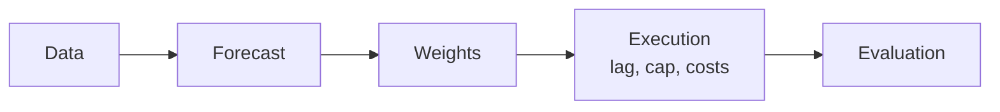

# volatility-managed-portfolio
Test and Implement volatility based strategy on managing portfolios risk

## Phase 1: Data and Set up

```bash
pip install -r requirement.txt
python -m src.data.build      # snapshot sources, build panels, run the pass rule
python -m pytest              # unit tests
```

The build writes `reports/phase1_data_report.md` (pass rule, coverage, sources) and
`data/events/event_dates.csv` (every FOMC, CPI and jobs-report date, with where it came from).

```python
from src.data.load import load_dev, load_etf_ohlc_dev

panel = load_dev()   # one row per trading day, 1926-07-01 .. 2018-12-31
```

`panel` columns: factor excess returns `mkt smb hml mom rmw cma bab`, ETF excess returns
`spy mtum qual usmv`, `rf`, `vix` and event flags `fomc cpi jobs`.

The holdout (2019 onward) sits in separate files, sealed by a content hash in
`data/holdout_lock.json`. It is opened once, in Phase 9, with
`load_holdout(confirm="phase 9 final test")`, and every opening is logged in
`data/holdout_access_log.csv`.

ETF history is short: MTUM and QUAL start in 2013 and USMV in 2011, leaving 5 to 7 years before 2019,
under the 10-year initial training window. So ETFs are never tuned on. Every model and cutoff is chosen
from the paper factors, and the ETFs are only checked against those choices.


## Phase 2: Variance and EDA

Variance:


Tests:
- 

- 

- 

- Test 4: to measure if its rewarding more if we hold less on the assets on risky times, if not then it would just be better for us to buy&hold. How it works:
1. Each month, score how volatile and record the returns and variance of each assets
2. Sort each pile of months from calmest to wildest and for each pile, compute their avg returns, variance, then the ratio
3. Then managed the return as for each month, multiply the next return by a weight which is c + last month variance. After a wild month, hold less, after a calm month, hold more
4. The constant c is set in order for managed and original have the asme volatility and allow them to be comparable, and not by their values
5. Compare managed with original: with regression managed: a + B * original then t-test to minimize chance of luck

## Phase 3: Assets Screening

Assets Screening with multiple filters to keep only assets with chance of success.

Filters:
- Predictable Risks: from test on phase 2, test 1 (fail: nothing to forecast). Result: all predictable

- Moving Risks: SD of log RV to measure how much variance moves (the idea is that if the risks is not moving with time, which is flat risk, then our whole idea of strategy would be useless as it would just be the same as buy&hold). Result: NO asset is flat

- Exploitability for Strats: risk to reward ratio on how our assets can be exploited, where the reward must fall when the risk rises. Such that our strategy of reducing out position weight can be reduced when its getting risky. If the risk and reward is one on one, then there is no use to adjust our position based on the risk. Test from Phase 2, test 4 (the test measures how rewarding is it from risky times compared to calm times). Result: Only 3 assets: Market, Momentum, and BAB.

- Stability: to ensure that the Strats is stable and applicable in all eras of time such that the Strats is still viable and not just based on specific era. Test: using the phase 2 test 4, implemented on splitting the history into 3 eras, then check if the a variable stays > 0 as a consistency check that the Strats is not a single era accident. The 3 eras are equal thirds of the history available at the as-of date (not fixed calendar years), so the filter never reads data from after that date and can run in real time.

- Systematic Risk (ETF): a long-only ETF is mostly market, so any ETF would pass an R² test on market exposure alone. The test therefore hedges the market out first (ETF minus its market beta times the market), then regresses the leftover tilt on market, size, value, momentum and BAB, and requires R² > 0.5. SPY is the market itself, so it is tested unhedged. Result: SPY and MTUM pass; USMV (0.38) and QUAL (0.17) fail.

- Tradeable (ETF): median daily dollar volume over the last 252 trading days above $50 million. The bid-ask spread half of the rule is not applied (no quote data).

Result: only Market (SPY) and Momentum (MTUM) survive. Betting-against-beta passes every factor filter but its ETF, USMV, fails the systematic risk filter.


## Phase 4: Portfolio Construction

Combine the survivors into one portfolio, then time that single portfolio (`src/portfolio.py`, report `reports/phase4_portfolio.ipynb`).

- Step 1, remove duplicates: drop one of any pair whose monthly returns correlate above +0.7, on all months or on the 10% most volatile months (a negative correlation is a hedge, not a duplicate). Result: nothing is cut. Market-momentum -0.30 (-0.58 in crises), market-BAB -0.14, momentum-BAB +0.27 (+0.44 in crises). Raw MTUM/QUAL/USMV correlate 0.89-0.98 with SPY, so the ETF track trades MTUM's hedged tilt (MTUM - β × SPY), which correlates -0.18 with SPY.

- Step 2, choose weights: four mixes (equal, inverse variance, inverse volatility, shrunk mean-variance), set every year-end from the last 10 years of daily returns and held for the next year. Inverse volatility is the primary.

- Step 3, combine then time: p = Σ wᵢ rᵢ; serving size = c / last month's variance of p, capped at 1.5x (1.0x, 2.0x and no cap in Phase 8); exposure to asset i = size × wᵢ. Tests 1 and 4 from Phase 2 are re-run on p (level φ is the gate, log φ reported beside it).

Tracks: paper (market + momentum + BAB, from 1941, the primary), ETF (SPY + MTUM tilt, from 2015: too short to judge), and paper market + momentum (the ETF track's long-history twin).

Result: the primary passes (Test 1 φ 0.514, Test 4 α 4.2% a year, t 6.1), so the phase passes, but Test 1 only narrowly, and it is an upper bound because the paper track holds BAB, which cannot be traded. Mixing lifts the Sharpe ratio from 0.55-0.85 for each piece to 1.14-1.17: that buy-and-hold mix is the bar timing has to beat.

```python
from src import portfolio as pf
rec = pf.recipes(panel, "paper")        # recipe per year-end and mix, from past data only
out = pf.returns(panel, "paper", rec)   # daily p, serving size and timed return per mix
pf.tests(out[("inv_vol", "p")])         # Tests 1 and 4 on the primary
```


## Phase 5: Strategy rules and the backtest engine

A backtester verified on simulated data before any real-data result is read (`src/engine/`, report `reports/phase5_engine.ipynb`, hand check `reports/phase5_hand_check.xlsx`).



Five modules, each tested alone (`test/test_engine.py`): `data` (what is traded: daily excess returns, rf, positions per unit of size), `forecast` (next month's variance from data up to each month-end), `weights` (size = c_t × signal, capped), `execution` (trade at the month-end close, drift, trading cost, borrowing, short fee), `evaluation` (Sharpe ratio, spanning alpha, break-even cost, placebo). A new forecast model is a function passed as `forecaster`; nothing else changes.

- Timing rules: inverse variance (c_t / σ̂², the primary), inverse volatility (c_t / σ̂), downside inverse volatility (c_t / σ̂⁻). Until Phase 6 picks a model, σ̂² is last month's realized variance.
- c_t in real time: sd(r_{s+1}) / sd(r_{s+1} × signal_s) over the months up to t (at least 120 pairs; 36 on the ETF track, Phase 7's three-year rule), so every rule carries buy-and-hold's risk without using future data. It is computed on the mix held next month, applied to all past data.
- Size between 0 and 1.5 (1.0 and 2.0 in Phase 8). Trading cost κ × |w_t − w̃_t| with drifted weights w̃; κ = 5 bp for SPY and 10 bp for factor ETFs; borrowed cash pays rf + 0.5% a year; the SPY short pays 0.25% a year (1% in Phase 8's stress test). Paper factors are before costs. Two kinds of break-even κ are reported, neither compared with Barroso and Santa-Clara's figures (which include trading inside the factor).
- Benchmark: the same book at size 1, traded on the same dates at the same costs.

Engine checks (`test/test_engine_checks.py`), all on simulated data, all passing:

| Check | Setup | Result |
|---|---|---|
| Two worlds | GARCH, 500 years; A: μ constant, B: μ ∝ σ² | A: α +1.95% (t 6.0); B: α +0.13% (t 0.4) |
| Constant forecast | σ̂² fixed, costs off | size exactly 1 (real-time c_t); α of order 10⁻¹⁶ |
| Shuffled forecast | 1,000 reorderings in time | mean alpha +0.002%; real beats 100% in A (pass), 67% in B (fail) |
| Oracle | next month's actual variance | A: +0.02 Sharpe over the baseline; unpredictable variance: +0.23 |
| Hand check | 5 months rebuilt with spreadsheet formulas | 70 numbers match to 2 × 10⁻¹⁴; 7 planted bugs all caught |

Placebo rule for the real data (from Phase 6): the real alpha must beat 95% of 1,000 shuffled alphas.

The primary test (PREREGISTRATION Entry 3) is the Sharpe gain over buy-and-hold, one-sided at 5%, with three readings: **edge** if it rejects, **no meaningful edge** if the one-sided 95% upper bound is below 0.10 a year, **inconclusive** otherwise. It is reported with the minimum detectable effect at 80% power, both runs' realized volatility and the average size. Its power is low. On simulated data it rejects in 30% of 90-year histories with a true edge (minimum detectable effect 0.18) and in 10% of holdout-length ones (0.46).

```python
from src import engine as e
from src import portfolio as pf
book = e.data.from_phase4(panel, pf.recipes(panel, "paper"), "inv_vol")   # the primary book
res = e.run(book, "inv_var")            # one row per holding month: decision, timed account, bench_ account
e.evaluation.sharpe_gain_test(res)     # the primary test: gain, bounds, reading, minimum detectable effect
e.placebo(book, "inv_var")              # real alpha vs 1,000 shuffled forecasts
```

```bash
python -m src.engine.handcheck          # rebuild the hand-check workbook (needs xlsxwriter and formulas)
```


## Phase 6: Forecast models

Which variance forecast makes the strategy work best, not just which has the smallest error (`src/models/`, report `reports/phase6_forecasts.ipynb`, rules in PREREGISTRATION Entries 4 and 5).

Every model forecasts the same thing: at each month-end close, the total variance of the next 22 trading days (one holding month), from data up to that close. Each runs its own expanding-window walk-forward on every recipe's mix. The fitted models are refit at every month-end (boosting yearly), and the direct models drop the last 22 days of training targets, because those targets overlap the forecast period.

| Model | Forecast | Expected to help if |
|---|---|---|
| M0 Rolling RV | Σ r² over the last 22 days | the papers' baseline |
| M1 EWMA | 22 × EWMA of r², λ = 0.94 | no fitting |
| M2 GARCH(1,1) | h-step forecasts summed over 22 days | short memory |
| M3 GJR-GARCH | GARCH plus a kick after down days | asymmetry |
| M4 HAR, log | log 22-day RV on 1-, 5-, 22-day log RV, direct, bias-corrected | long memory |
| M5 Downside HAR | M4 plus each lag's down-day share | long memory plus asymmetry |
| M6 HAR-X | M4 (Test 3 failed) plus log VIX variance and scheduled-event counts | VIX adds information |
| M7 Gradient boosting | M6's inputs, QLIKE (gamma) loss, tuned by an inner walk-forward | nonlinearity |

Two scorecards, on the same months:
- **A. Accuracy:** QLIKE, with the Model Confidence Set at 90%.
- **B. Strategy value:** each forecast plugged into the Phase 5 engine at the primary specification. Sharpe ratio, CER (γ = 5), volatility, the primary test, the placebo.

The rule, fixed in advance: **the simplest model inside the MCS whose Sharpe ratio is within one standard error of the best** (the error of the gap, by the primary test's method).

Results (development sample; the primary book is an upper bound: paper BAB, no costs):

| | Primary (market + momentum + BAB), 1950–2018 | SPY reference (market factor, SPY's costs), 1946–2018 |
|---|---|---|
| Most accurate | M6 HAR-X (QLIKE 0.303); only M0 outside the MCS | M6 HAR-X (0.273); M0, M1, M7 outside the MCS |
| Sharpe ratio, eight models | 1.51–1.57 (buy-and-hold 1.21); all "edge", all pass the placebo | 0.50–0.53 (buy-and-hold 0.50); all "inconclusive" |
| Oracle (perfect forecast) | 2.22 | 1.12 |
| Accuracy vs value, rank correlation (Q4) | +0.10: accuracy is not the bottleneck | +0.62 |
| **Frozen choice** | **M3 GJR-GARCH**: best Sharpe; EWMA missed the rule by 0.002 | **M2 GARCH(1,1)** |

- **A perfect forecast would add far more than any of these models.** The oracle beats rolling RV by 0.6–0.7 Sharpe, while the eight models differ by only 0.03–0.06.
- **The Sharpe ranking follows the average size, not accuracy.** On the primary book the GARCH models sit mid-table on QLIKE but win on Sharpe. Their smooth forecasts let the real-time c_t hold a larger size (1.0 against rolling RV's 0.67), and the cap binds more often.
- **A bug was found and fixed after the first run (Entry 5).** The GARCH optimizer reported success at absurd parameters, and some GJR forecasts reached 10¹⁰ times the realized variance. That made the first run's choice for the primary (rolling RV) void. The fix scales ω and never accepts a worse likelihood than the start. Its estimates match the `arch` package to four decimals. The first run's tables are kept in `reports/phase6_first_run_*.csv`.

```python
from src import models as md
from src.models import build, scorecard as sc
specs = build.setup(panel)                       # "paper" and "spy": book, costs, the eight forecasters
res = sc.run(specs["paper"]["book"], specs["paper"]["fs"]["M3"], specs["paper"]["costs"])   # the frozen model in the engine
```

```bash
python -m src.models.build      # fill the forecast cache in parallel (about an hour on 10 cores the first time), run the placebos, write reports/phase6_*.csv
```
