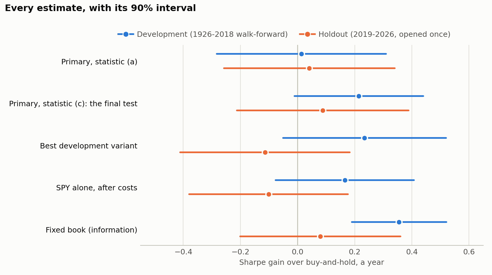
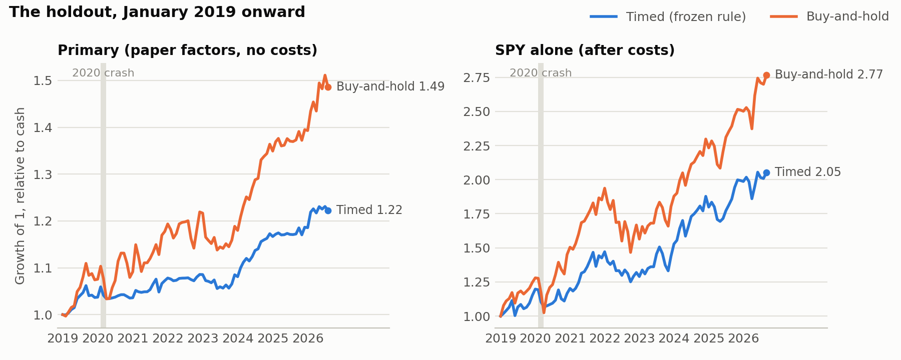

# Volatility timing in real time: a pre-registered test with a sealed holdout

*Research report on Phases 1–9, with a postscript on Phase 10 · October 2026. Every number here traces to `PREREGISTRATION.md` (Entries 1–14) or to a table in `reports/`. Paper-factor results are upper bounds: those books carry no trading costs, and two of their factors cannot be traded.*

## Summary

Scaling a portfolio by the inverse of its own forecast variance means holding less when risk is high and more when it is low. It is one of the best-known results in empirical asset pricing (Moreira and Muir 2017). This study asks a narrower question: **does it beat simply holding the same portfolio when every choice is made in real time, from past data only, and judged on data no choice ever saw?**

- **The answer is that we cannot tell, and the data rule out a large edge more than they support a small one.**
  - The pre-registered final test, run once on a holdout sealed before any modelling began, gained **+0.088** in Sharpe ratio a year over buy-and-hold (one-sided p = 0.31).
  - The smallest gain that 91 months could detect with 80% power is **0.45**. Detecting +0.088 reliably would take about **200 years** of data.
  - None of the five books run on the holdout read "edge", and none read "no meaningful edge".
  - The result is consistent with Cederburg et al. (2020): volatility management does not reliably beat its unmanaged portfolio in real time.
- **What timing did reliably was cut risk.** The timed books ran at lower volatility with smaller drawdowns, and they cut size before most of the worst days in 2000–2002, 2008, 2020 and 2022.
  - The price was missed rebounds and a lower certainty-equivalent return. In the year after March 2020's trough, timed SPY gained 19% against buy-and-hold's 77%.
  - Part of the drawdown cut is simply the smaller average size (Section 6).
- **Three side findings.**
  - Forecast accuracy did not track strategy value (rank correlation −0.05 across eight models).
  - The models' Sharpe ranking followed their average position size instead (+0.76).
  - On development, one market-only year (1984) decided the verdict.

A pre-registered, sealed-holdout null is a finding in itself. The sections below show why this one came out as it did and what it can and cannot rule out.

After the holdout, three follow-ups on development data (Phase 10) found no new edge: a variance-risk-premium signal, four fixes to the timing rule, and the rule as a pure risk overlay. None reached a holdout. The postscript has the findings.

---

## 1. The question

Moreira and Muir (2017) show that scaling a factor by c / σ̂²_t, the inverse of last month's realized variance, raises its Sharpe ratio, and that the managed factor has a large positive alpha on the unmanaged one. Barroso and Santa-Clara (2015) report the same for momentum: its Sharpe ratio nearly doubles. The idea is simple. If volatility is persistent and expected returns do not rise with it, risk taken in turbulent months is poorly paid, so holding less then and more in calm months improves the trade-off.

Two problems sit under the headline numbers:
- **Hindsight.** The scaling constant c is set on the full sample, and the alpha is a spanning regression. That alpha says the *best ex-post mix* of managed and unmanaged would have beaten the unmanaged factor. It does not say an investor would have known that mix in advance.
- **Real time.** Cederburg, O'Doherty, Wang and Yan (2020) form those combinations in real time across a large set of strategies. Most do not beat their unmanaged versions out of sample.

So the honest test is not "is there an alpha?" but **does the managed portfolio, built with only what was known at each date, beat buy-and-hold after costs, on data it has never seen?**

**Hypotheses** (Entry 1).
- **H1:** the volatility-managed mix has a higher Sharpe ratio than the buy-and-hold mix in the holdout, after costs.
- **H0:** it does not. This is the skeptic's prior.

The benchmark is demanding by design: the same assets and the same mix weights at a constant size. On development data that buy-and-hold mix has a Sharpe ratio of 1.14–1.17.

## 2. Design

### 2.1 Data and the sealed holdout

| Item | Rule |
|---|---|
| Sources | Kenneth French's daily factors (market, size, value, profitability, investment, momentum); AQR's betting-against-beta (BAB), daily; SPY, MTUM, QUAL and USMV from Yahoo; CBOE's VIX; FOMC, CPI and jobs-report dates. Each raw file's URL, fetch time and SHA-256 are recorded |
| Development sample | 1 July 1926 to 31 December 2018. All analysis, tuning and choosing happen here |
| Holdout | 1 January 2019 to 31 August 2026. Sealed by content hash on 7 October 2026, before any modelling; readable only through a logged loader that checks the hash. Opened once, on 20 October 2026 |
| Data checks | Nine gating checks (one trading calendar, no missing days, SPY against an independent S&P 500 source, known extreme days, bounds, event counts, a non-overlapping split). All passed before anything else ran |

The ETFs have only 5–7 years of history before 2019 (MTUM and QUAL start in 2013), so no rule was ever tuned on them. Every cutoff comes from the paper factors.

### 2.2 The pipeline: one decision at a time, from past data only

At every rebalance, using only data up to that close, the strategy does five things:

1. **Screen** (each year-end). Seven factors pass or fail three filters: their risk is predictable, their reward falls when risk rises, and that holds in each third of their history so far.
2. **Mix.** Survivors that duplicate another (correlation above +0.7) are dropped. The rest get inverse-volatility weights from the last 10 years of daily returns, held for the next year.
3. **Forecast** next month's variance of the mix (Section 2.3).
4. **Size.** size_t = c_t / σ̂²_t, capped at 1.5. The constant c_t is estimated in real time, from the pairs of signal and next-month return observed so far (at least 120; 36 on the ETF track), so that the timed and untimed mix have the same variance over that history. The papers set c once on the full sample; here it never sees the future.
5. **Trade** at that day's close: monthly execution with drift inside the month, costs charged on the trade, borrowing above size 1 at rf + 0.5%.

**The benchmark** is the same book at size 1, traded on the same dates at the same costs. So the timed and untimed runs differ only in size.

**Costs.** SPY pays 5 bp a trade and factor ETFs 10 bp, with a 0.25% a year short fee on SPY. The paper factors carry no costs, which is one reason their results are upper bounds.

The backtest engine was verified before any real-data result was read. On simulated data it showed:
- the right answer in a world where timing should work and in one where it should not;
- a size of exactly 1 when the forecast is constant;
- a hand-built spreadsheet matching 70 of its numbers to 2 × 10⁻¹⁴, and catching all seven planted bugs.

### 2.3 Forecast models

Eight models forecast the same target: the variance of the next 22 trading days, from data up to each month-end. Each runs its own expanding-window walk-forward.

| Model | Forecast |
|---|---|
| M0 | Σ r² over the last 22 days (the papers' baseline) |
| M1 | EWMA, λ = 0.94 |
| M2, M3 | GARCH(1,1); GJR-GARCH (an extra response to down days) |
| M4, M5 | HAR in logs; HAR with each lag's down-day share |
| M6 | HAR plus log VIX variance and the count of scheduled FOMC, CPI and jobs days ahead |
| M7 | Gradient boosting on M6's inputs, QLIKE loss, tuned by an inner walk-forward |

**The selection rule, fixed in advance:** the simplest model inside the 90% Model Confidence Set on QLIKE whose Sharpe ratio is within one standard error of the best. It chose **M3** for the paper book and **M2** for SPY.

### 2.4 The primary test

| Item | Rule (Entry 3) |
|---|---|
| Statistic | The Sharpe gain: Sharpe(timed) − Sharpe(buy-and-hold), a year, from monthly excess returns after the book's costs |
| Test | One-sided at 5%. The standard error is the Ledoit and Wolf (2008) delta method with a Newey-West covariance (6 lags) |
| Readings | **edge** if the test rejects; **no meaningful edge** if the one-sided 95% upper bound is below 0.10; **inconclusive** otherwise |
| Reported with it | The minimum detectable effect (MDE) at 80% power, both runs' volatility, and the average size |
| Families | Romano-Wolf stepdown and Holm adjusted p-values (stationary bootstrap, mean blocks 6 and 12, the larger p kept), and the deflated Sharpe ratio of the best variant |

The power was measured on simulated data before any real result:
- in 90-year histories where timing truly adds about 0.09, the test rejects 30% of the time (MDE 0.18);
- in 92-month histories, the holdout's length, it rejects 10% of the time (MDE 0.46).

**The holdout was therefore never going to prove a small edge. It could catch a large failure.**

### 2.5 Pre-registration

Each phase's rules went into a dated entry in `PREREGISTRATION.md` before the results they govern.
- An entry is never edited once its results exist. A correction is a new entry that names what it replaces.
- Every rule table in code is read-only and pinned by fingerprint to the commit that fixed it.

This was not true from the start, and the record says so. Phases 1–4 were run before the file had rules, so Entry 1 *records* them rather than pre-registering them, and lists every change made after a first run. Two later fixes after a first run are also recorded:
- a GARCH optimizer bug in Phase 6;
- a scoring error for weekly runs found in code review (Entry 12).

Before the holdout was opened, the final build was rehearsed end to end on development data, with a pseudo-holdout from 2011. Appending the real holdout then changed nothing before 2019: every run reproduced its development run exactly, a largest gap of 0 on every month.

## 3. What development showed

### 3.1 Volatility is predictable; its reward is not proportional (Phases 2–4)

- **Every asset's risk is predictable** (Phase 2, Test 1: Ljung-Box on r², and a monthly AR(1) slope of realized variance above 0.5).
- **Only three have a reward that falls when risk rises:** the market, momentum and BAB (Test 4: next month's mean over variance is lower in the wildest variance quintile, and the managed factor has a positive spanning alpha).
- **Those three became the paper book.** Market, momentum and BAB, with inverse-volatility weights.
  - It passes both tests, narrowly on persistence (φ 0.514; alpha 4.2% a year, t 6.1).
  - Mixing lifts the Sharpe ratio from 0.55–0.85 for each piece to 1.14–1.17 for buy-and-hold. That is the bar timing has to clear.
- **The ETF track.** SPY, and SPY plus MTUM's market-hedged tilt, were the tradeable versions. BAB has no tradeable stand-in: USMV failed the systematic-risk filter.

### 3.2 Forecast models: a large edge on a fixed list of assets (Phase 6)

On Phase 6's book (market, momentum and BAB, fixed for all years, 1950–2018), every one of the eight models beats buy-and-hold:

| Book | Sharpe ratio, eight models | Buy-and-hold | Oracle (next month's actual variance) | Reading |
|---|---|---|---|---|
| Paper book (upper bound) | 1.51–1.57 (M3: 1.567) | 1.21 | 2.22 | all **edge**; all pass the placebo |
| SPY reference (the market factor at SPY's costs) | 0.50–0.53 | 0.50 | 1.12 | all **inconclusive** |

- **The room to win is large; the models take little of it.** The oracle beats rolling RV by 0.6–0.7, while the eight models differ by only 0.03–0.06.
- **The market alone barely responds.** On the market factor, timing adds almost nothing: +0.030 over 870 months (p 0.32).

**The fixed book's edge has a problem: its asset list was chosen with the whole development sample** (Phase 3's full-sample screen). Phase 7 removes that look-ahead.

### 3.3 The real-time walk-forward: the edge disappears (Phase 7)

With the screen run at each year-end on data up to that date, the primary book is far less tidy:
- In 1984 the screen admits only the market.
- From 1997 it holds mixes of market, BAB, profitability and, from 2010, momentum.
- In other years nothing passes, or the mix has no c_t yet, and the account holds cash.

It scores 276 months.

| | Sharpe, timed / buy-and-hold | Gain (p) | Reading |
|---|---|---|---|
| **Primary**, 276 months (M3, inverse variance, inverse-volatility mix, monthly) | 0.746 / 0.733 | **+0.013 (0.47)** | **inconclusive** (MDE 0.45) |
| Family of 192 variants (8 models × 3 rules × 4 mixes × 2 frequencies) | median gain +0.09; 185 of 192 positive | 1 raw p < 5%; **0 after Romano-Wolf or Holm** | best variant's deflated Sharpe ratio 0.67 (bar 0.95) |
| ETF track: SPY alone, after costs, 1997–2018 | 0.582 / 0.417 | +0.165 (0.13) | inconclusive |
| Phase 6's fixed book (full-sample asset list) | 1.567 / 1.211 | +0.355 (0.0002) | edge |

The primary also earned less in certainty-equivalent terms (CER 3.47% against 4.12% at γ = 5), and it failed the placebo. Its real alpha beat 86% of 1,000 shuffled forecasts, against a 95% bar.

**One year decided the development verdict.** This was found after the run and is labelled a diagnosis.
- In 1984 the book was the market alone, at 14–19% volatility, against 2–9% for the mixes that followed.
- A pooled Sharpe ratio weights each month by its variance, so those 12 months carried about as much weight as the 264 after them.
- In 1984 the timed run lost 9.4% a year against buy-and-hold's 4.8%.
- **Without 1984, the primary gains +0.30 (p 0.012),** and 65 of 192 variants survive Romano-Wolf.
- Phase 6's fixed book gains +0.61 on the same 276 months. So the real-time asset list, not the years, removed most of Phase 6's edge.

Because a one-asset year could dominate the holdout the same way, a statistic was fixed before the holdout opened, as option (c) (Entries 10–11). Each holding year's returns, timed and buy-and-hold alike, are scaled by 1 over buy-and-hold's volatility in that year's 10-year window, known at the year-end, so each year carries a similar risk budget. On development, computed after the rule was fixed, (c) gives +0.214 (p 0.059): still inconclusive.

### 3.4 Robustness: sturdy where the asset list was fixed, fragile where it was not (Phase 8)

Each check changes one thing.

| Base | Gain | What holds | What breaks it |
|---|---|---|---|
| Primary, 276 months | +0.013, inconclusive | frequency, window, cap, rule, combine order | turns negative from 5 bp a trade (break-even 3 bp); negative without BAB; placebo fails |
| Primary, 1997–2018 | +0.30, edge | everything keeps its sign | without BAB +0.07; inconclusive from 20 bp (break-even 47 bp) |
| Fixed book | +0.36, edge | no leverage (cap 1.0: +0.28), 30 bp plus borrowing (+0.18), dropping any factor | no edge in 1950–1962 (+0.03) |

**Rebalancing more often raises every paper gain.** Daily rebalancing gives the fixed book +0.66, but part of that is probably not tradeable. The gain is largest in 1963–1990, when the paper factors' daily returns were most autocorrelated (AR(1) 0.38), as stale closing prices produce.

**The development picture going into the holdout:**
- the registered primary was inconclusive and fragile in sign;
- the best variant had been picked from 192 and was heavily discounted by its deflated Sharpe ratio;
- the only clear edge belonged to a book whose assets had been chosen with hindsight.

## 4. The holdout (Phase 9)

The holdout was opened once, on 20 October 2026, with code, models, parameters and cutoffs frozen. Every run continued its development walk-forward, so each decision read only data up to its own close. Appending the holdout changed nothing before 2019 (a largest gap of exactly 0 on every development month). The screen held market, momentum and BAB at every year-end, plus profitability for 2020 and 2022. The paper books end in July 2026, because AQR's BAB file ends a month early.

| Book | Statistic | Months | Sharpe, timed / buy-and-hold | Gain | Standard error | p | MDE | Reading |
|---|---|---|---|---|---|---|---|---|
| **Primary (the final test)** | (c) | 91 | 0.744 / 0.656 | **+0.088** | 0.183 | **0.31** | 0.45 | **inconclusive** |
| Primary | (a) | 91 | 0.897 / 0.855 | +0.041 | 0.182 | 0.41 | 0.45 | inconclusive |
| Best development variant | (c) | 91 | 0.651 / 0.765 | −0.114 | 0.180 | 0.74 | 0.45 | inconclusive |
| SPY alone, after costs | (a) | 92 | 0.790 / 0.891 | −0.102 | 0.169 | 0.73 | 0.42 | inconclusive |
| SPY + MTUM tilt, after costs | (a) | 92 | 0.482 / 0.468 | +0.015 | 0.179 | 0.47 | 0.44 | inconclusive |
| Fixed book (information) | (a) | 91 | 0.857 / 0.777 | +0.080 | 0.170 | 0.32 | 0.42 | inconclusive |



*Figure 1. Each pre-registered Sharpe gain on development (blue) and on the holdout (orange). Each line runs between the one-sided 95% bounds the readings use, which together form a 90% interval. Every holdout interval crosses zero, and every one also reaches above +0.10. Source: `reports/phase7_*.csv`, `phase8_year_weighted.csv`, `phase9_results.csv`.*

**Reading, under the rule fixed before the holdout (Entry 13).** A book that did not win on development is "consistent with Cederburg et al." whatever the holdout shows. That covers the primary, the best variant and both ETF books. The fixed book, the only development winner, kept about a quarter of its edge (+0.080 against +0.355). Its holdout reading is "too short to tell".

**The pattern behind the numbers.** Every holdout gain sits below its development gain under the same statistic, except the primary under (a), whose development gain 1984 had held near zero. The best variant fell from +0.234, the best of 192, to −0.115, as its deflated Sharpe ratio of 0.67 had warned.



*Figure 2. Growth of 1 relative to cash over the holdout. Primary: January 2019 to July 2026. SPY: to August 2026. The timed primary ran at 3.0% volatility against 6.4%, and timed SPY at 13.0% against 16.5%. Source: `data/processed/phase9_runs.parquet`.*

## 5. Why it came out this way

**1. The edge, if any, is small, and the samples are short.**
- The holdout's standard error of the Sharpe gain is 0.18, so its MDE is 0.45.
- To detect the final test's +0.088 with 80% power, the standard error would have to shrink about fivefold. That needs roughly 2,400 months: about 200 years.
- Even 92 years of development data has an MDE near 0.16–0.18 for single books.
- Timing the market alone gained +0.03 over 870 development months. Effects of that order cannot be confirmed or refuted on any sample available here.

**2. The headline results lean on hindsight.**
- The large published alphas use a scaling constant and an asset list set on the full sample, and measure the best ex-post combination.
- This study set both in real time. The constant c_t is expanding. The asset list is screened yearly, on data up to the year-end.
- Phase 6's fixed book, which used the full-sample asset list, showed the familiar large edge (+0.355). The same rule on the real-time list showed none (+0.013).

**3. On the market, the gain is close to zero even on long data.**
- Timing the market factor alone added +0.030 over 870 months.
- SPY, the only tradeable book that lasts the whole holdout, lost 0.10 there.
- The 2020 rebound is the clearest single cost: risk was cut in March, and the size stayed low as prices rose.

**4. Not costs, and not bad data.**
- Timed SPY's trading costs were about 0.2% a year (turnover 3.9 a year at 5 bp). Against 13% volatility that is about 0.015 of Sharpe, far below the 0.10 it lost.
- The development outliers (1984, October 1987, 2020) are real market events, and the data passed independent checks.

**5. A more volatile holdout shrank the size, not the Sharpe gain.**
- From 2019 to 2026, M3's forecast of the mix's volatility averaged 7.8% a year, against 5.3% in 1997–2018.
- c_t is set on all history, so the size averaged 0.47 and never reached the cap.
- A Sharpe gain does not depend on size. CER and drawdowns do, which is why the timed primary earned less (CER 2.5% against 4.4%) and fell less.

## 6. What timing reliably did

**It cut risk.**
- All 192 development variants had smaller maximum drawdowns than buy-and-hold, and 190 had higher Sortino ratios.
- On the holdout, the primary's drawdown was −2.8% against −6.8%, and SPY's −15.0% against −24.3%.

**Part of that is the smaller size, not the timing.** A book held at half size halves its drawdown with no timing at all, so the fair comparison scales buy-and-hold to the timed run's volatility. This is approximate, scaling each drawdown by the volatility ratio:

| Book | Volatility, timed / buy-and-hold | Maximum drawdown, timed | Buy-and-hold | Buy-and-hold at the timed volatility (approximate) |
|---|---|---|---|---|
| Primary, development (276 months) | 5.8% / 7.6% | −18.9% | −33.5% | about −26% |
| Primary, holdout | 3.0% / 6.4% | −2.8% | −6.8% | about −3.2% |
| SPY alone, holdout | 13.0% / 16.5% | −15.0% | −24.3% | about −19% |

Timing cut drawdowns beyond what the smaller size explains: clearly on development and on SPY, and only marginally on the holdout's primary.

**It usually cut before the worst days, when volatility built up first.**

| Episode | Before or after the worst days | The rebound |
|---|---|---|
| 2000–2002 | Before: sizes 0.10–0.17 on buy-and-hold's five worst days, 11–16% of its loss | the mixes rose through the market's fall (fixed book +29% against +52%) and slipped in its rebound (−0.5% against −5.9%) |
| 2008–2009 | Before: 0.17–0.31, 18–29% of the loss | the primary missed part of it (+4.6% against +13.3%) |
| October 1929, October 1987 | After: the crash came out of calm. The fixed book took 91% of October 1987's loss | the market (Barroso and Santa-Clara's rule) missed 1932's: +44% against +180% |
| 2020 (holdout) | Before most of them: March's size was set after the first week of selling. Primary 0.28 and SPY 0.25 on the worst days, taking 22–24% of the loss | **missed**: SPY +19% (size 0.67) against +77%; primary +2% against +12% |
| 2022 (holdout) | Before: SPY from 1.3 to 0.37 on its worst days | partly missed: SPY +11% against +17% |

**It protected momentum from its crashes.** In March–May 2009, momentum at size 1 lost 46%; the frozen rule, at a size of 0.06, lost 2%. In the year after March 2020's trough, momentum lost 32%; the frozen rule, at 0.17, lost 7%.

**What it cost.**
- Missed rebounds.
- A lower certainty-equivalent return wherever the size ran below 1: CER 3.5% against 4.1% on development, 2.5% against 4.4% on the holdout.
- A placebo that failed on both samples: the real alpha beat 86% of 1,000 shuffled forecasts on development and 70% on the holdout.

As a risk control it worked as designed. As a return enhancer it did not show up.

## 7. Side findings

- **Forecast accuracy did not track strategy value.**
  - Across the eight models, the rank correlation between accuracy (QLIKE) and the Sharpe gain was −0.05 on the walk-forward's primary cell, and +0.10 on Phase 6's fixed book.
  - M6 was the most accurate model, yet in 168 comparisons against rolling realized variance, no model beat it (no raw p below 5%).
  - The oracle shows the room is large (+0.6 to +0.7 Sharpe); real forecasts did not capture it.
- **The Sharpe ranking followed average size.**
  - On the fixed book, the models' Sharpe ranking correlated +0.76 with their mean size.
  - The GARCH models produce smoother forecasts, so real-time c_t lets them hold more (mean size 1.00 against rolling RV's 0.67). The 1.5 cap then binds more often (25% of months against 11%).
  - Under a cap, a rule's Sharpe ratio depends on how its size distribution meets the cap, not only on forecast skill.
- **One year can decide a pooled test.** A Sharpe ratio pools months by their variance. When one stretch of a book is a different kind of portfolio, with several times the volatility (14–19% in 1984 against 2–9% after), it dominates. Option (c), fixed before the holdout, is the remedy this study adopted.
- **The process caught its own errors.**
  - The Phase 6 GARCH optimizer reported success at absurd parameters, which voided the first model choice.
  - A code review found weekly runs scored by the wrong month.
  - Both were fixed, recorded and re-run before the holdout was opened. The simulated engine checks and the run-once rule are what made those fixes safe to make.

## 8. Limits

- **The paper results are upper bounds.**
  - The paper books carry no trading costs, and BAB and profitability cannot be traded as defined.
  - The ETF track, which can be traded, is short: SPY + MTUM has 20 development months.
  - Daily paper results may include stale-price autocorrelation.
- **Every sample is short for effects this small.**
  - The holdout's MDE is 0.45, and development's roughly 0.16–0.45, depending on the book.
  - A true gain of 0.1 would most likely read "inconclusive" on any of them.
- **Development was not untouched by the end.** Phases 6–8 reused development walk-forward results to choose and check models. Only the holdout was never seen before the final test.
- **Phases 1–4 were recorded, not pre-registered** (Entry 1). The phase reports, not the commit history, are the evidence of what was fixed before each first run.
- **One market, one holdout path.** US equity factors only. 2019–2026 was more volatile than the history c_t learned from, and it held one sharp V-shaped crash, the pattern a volatility rule handles worst.
- **The cost model is simple.** Spreads were never measured against quotes, market impact is ignored, and trading inside each factor is not priced.

## 9. Conclusion

Built and judged in real time, volatility timing of a diversified factor portfolio did not reliably beat holding it:
- On development the registered test was inconclusive (+0.013). On a holdout sealed before any modelling it was inconclusive again (+0.088, p 0.31, MDE 0.45).
- The large development edge belonged to a book whose assets had been chosen with hindsight, and on the holdout it shrank to a quarter.
- What the rule did reliably was manage risk: smaller drawdowns, lower volatility, sizes cut before most crashes that built up gradually. Its costs were missed rebounds and a lower certainty-equivalent return.

The study cannot rule out a modest true edge of the size the literature reports for the market. No sample here could. What it can say is that the large real-time gains a reader might expect from the headline results did not appear: not on 92 years of development data under a real-time rule, and not on 91 months the rule had never seen.

## Postscript: Phase 10, after the holdout (development data only)

After the holdout was opened, three follow-ups asked whether volatility forecasts are worth more elsewhere, or under a better rule.
- **Each was pre-registered before it ran** (`PREREGISTRATION.md`, Entries 15–27).
- **Each ended on development data.** None passed the test that would have sent it to a holdout, so Holdout B was not reopened and no strategy was frozen for the sealed forward sample (September 2026 onward).

**1. The variance risk premium predicts returns, but added nothing as a sizing signal** (Entries 18–23).
- **The signal.** VRP is VIX's implied monthly variance minus our forecast of next month's variance.
- **It predicts returns.** On 1990–2018 it predicts the market's excess return 1, 3 and 6 months ahead:
  - in all nine combinations of three forecast models and three horizons (t from 3.6 to 6.2);
  - with the same sign in each third of the sample;
  - beating a plain average out of sample (R² from 1.0% to 8.3%).
- **As a sizing signal it added nothing.** SPY was sized by c_t × μ̂ / σ̂², with μ̂ forecast from VRP. Over 251 months after costs it did no better than volatility timing alone: −0.015 in Sharpe ratio (p 0.56).
- **Why it didn't help is not settled.** Measured the same way, μ̂ and the variance forecast spread about equally, and a high VIX lifts both, so they partly cancel. VRP changed the size; it did not improve the Sharpe ratio.

**2. Four fixes to the timing rule did not survive adjustment for testing four** (Entries 17, 20, 24).
- **The fixes:**
  - a fixed 50/50 blend with an inverse-volatility rule (Wang and Yan's scaling);
  - the same on downside volatility;
  - conditional targeting (size 1 except when forecast volatility is in its top or bottom 20%);
  - a 10-month trend gate.
- **The test:** the market factor at SPY's costs, 870 months (1946–2018).
- **The result:**
  - The gains were positive (+0.026 to +0.064), but none survived Romano-Wolf (smallest adjusted p 0.075).
  - The fixed blend reads "no meaningful edge": its gain is at most about 0.06.
  - The trend gate recovered twice the frozen rule's 2009 rebound (+33% against +15%), but under half of buy-and-hold's (+75%).
- **On the paper factor mix the two blends do survive** (+0.09 and +0.11), consistent with Wang and Yan's evidence on factor portfolios. That book cannot be traded.

**3. Volatility timing's risk benefit comes in episodes, not month to month** (Entries 22, 25–26).
- **Month to month,** timing by inverse volatility steadied the market's volatility only slightly. The spread of log monthly volatility, timed over buy-and-hold, was R = 0.94 over 1946–2018.
- **In crises the cut was large.** Over 1998–2018, timed SPY's maximum drawdown was −31% against buy-and-hold's −56%. Part of that is the smaller size: scaled to the timed rule's volatility, buy-and-hold's drawdown is about −40%.
- **Neither can be tested forward in practice.**
  - A 36-month forward test of the month-to-month effect has about 8% power, and 80% would take centuries.
  - A test of the crisis effect needs crises, and there are a few a century.

**4. Whether a rule steadies risk depends on its power and on the forecast** (simulation, Entry 25).
- **The setup:** a simulated GARCH world, sized on the true monthly volatility with no cap.
- **Inverse volatility steadies monthly risk** (R = 0.67).
- **Inverse variance, the papers' rule, does not** (R = 1.00). It swaps calm and wild months rather than evening them out.
- **On a forecast that ignores mean reversion within the month,** inverse variance makes risk *less* steady than buy-and-hold (R = 1.19).
- **These are simulated results.** On real data the inverse-volatility rule's effect shrank from R = 0.67 to 0.94. Forecast error and the 1.5 cap are the likely reasons; neither was tested.

**What closes Phase 10.** No new edge was found. The effects that are real here — VRP's link to future returns, and timing's cut in crisis drawdowns — are too small, or too rare, to confirm on any forward sample of practical length.

## References

- Bailey, D. H., and M. López de Prado (2014). The deflated Sharpe ratio. *Journal of Portfolio Management*.
- Barroso, P., and P. Santa-Clara (2015). Momentum has its moments. *Journal of Financial Economics*.
- Cederburg, S., M. S. O'Doherty, F. Wang, and X. S. Yan (2020). On the performance of volatility-managed portfolios. *Journal of Financial Economics*.
- Frazzini, A., and L. H. Pedersen (2014). Betting against beta. *Journal of Financial Economics*.
- Holm, S. (1979). A simple sequentially rejective multiple test procedure. *Scandinavian Journal of Statistics*.
- Ledoit, O., and M. Wolf (2008). Robust performance hypothesis testing with the Sharpe ratio. *Journal of Empirical Finance*.
- Lo, A. W. (2002). The statistics of Sharpe ratios. *Financial Analysts Journal*.
- Moreira, A., and T. Muir (2017). Volatility-managed portfolios. *Journal of Finance*.
- Politis, D. N., and J. P. Romano (1994). The stationary bootstrap. *Journal of the American Statistical Association*.
- Romano, J. P., and M. Wolf (2005). Stepwise multiple testing as formalized data snooping. *Econometrica*.
- Wang, F., and X. S. Yan (2021). Downside risk and the performance of volatility-managed portfolios. *Journal of Banking and Finance*.

## Appendix: where each number lives, and how to rebuild it

| Phase | Rules and outcome | Code | Report and tables |
|---|---|---|---|
| 1 Data | Entry 1 | `src/data/` | `reports/phase1_data_report.md` |
| 2 Variance | Entry 1 | `src/variance.py` | `reports/phase2_variance.ipynb` |
| 3 Screening | Entry 1 | `src/screen.py` | `reports/phase3_screening.ipynb` |
| 4 Portfolio | Entry 1 | `src/portfolio.py` | `reports/phase4_portfolio.ipynb` |
| 5 Engine and test | Entries 2–3 | `src/engine/` | `reports/phase5_engine.ipynb`, `phase5_hand_check.xlsx` |
| 6 Forecast models | Entries 4–5 | `src/models/` | `reports/phase6_forecasts.ipynb`, `phase6_*.csv` |
| 7 Walk-forward | Entries 6–7 | `src/walkforward/` | `reports/phase7_evaluation.ipynb`, `phase7_*.csv` |
| 8 Robustness | Entries 8–12 | `src/robustness/` | `reports/phase8_robustness.ipynb`, `phase8_*.csv` |
| 9 Holdout | Entries 13–14 | `src/holdout/` | `reports/phase9_holdout.ipynb`, `phase9_*.csv` |

```bash
pip install -r requirement.txt
python -m src.data.build              # Phase 1: snapshot, panels, checks, the seal
python -m src.models.build            # Phase 6 (about an hour on 10 cores the first time)
python -m src.walkforward.build       # Phase 7
python -m src.robustness.build        # Phase 8
python -m src.holdout.build --rehearse   # Phase 9 on development data only; the real run refuses to run twice
python -m src.writeup                 # this report's two figures, from saved outputs only
```
